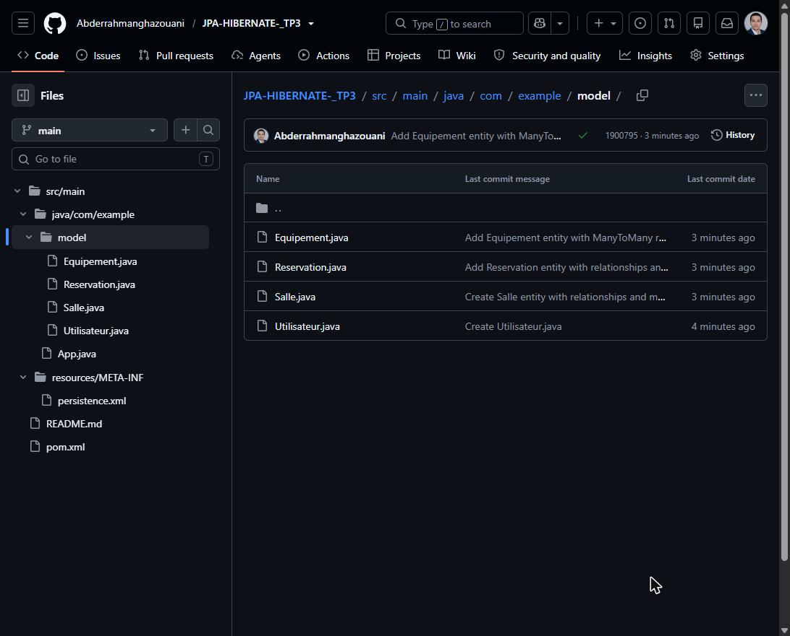
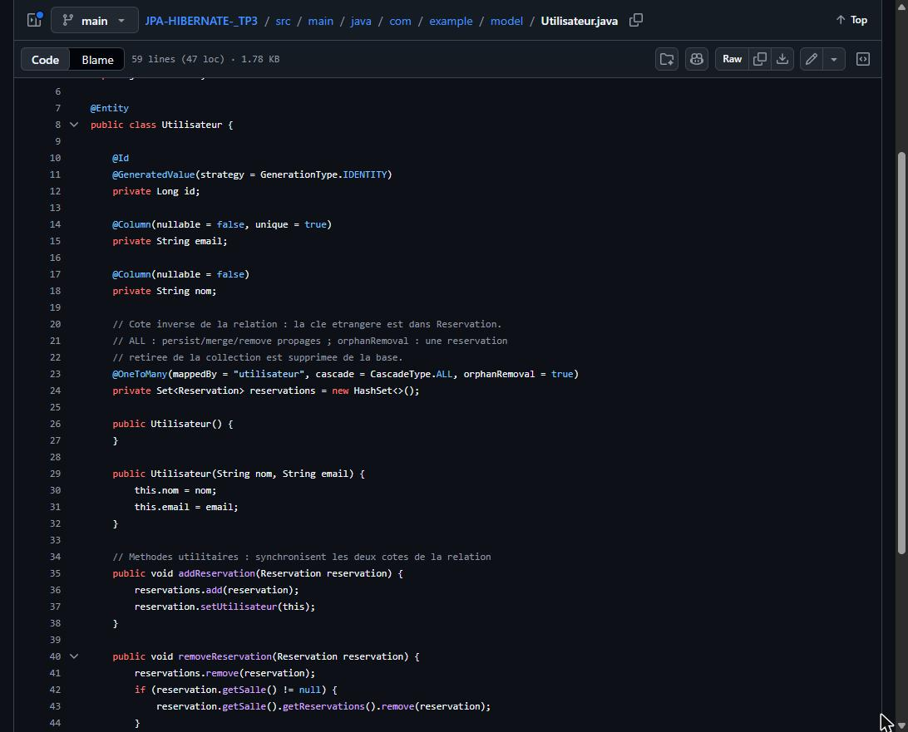
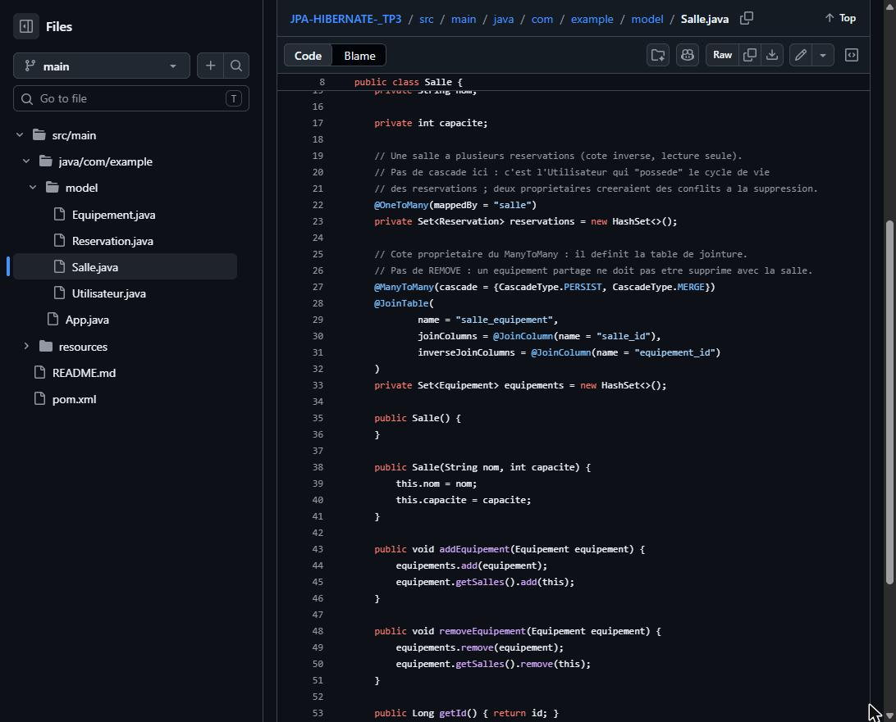

# TP 3 — Entités Salle, Réservation, Utilisateur et Équipement avec JPA & Hibernate

## Objectif
Créer des entités JPA liées entre elles (OneToMany, ManyToOne, ManyToMany) et tester les cascades et la suppression orpheline.

## Technologies
Java 17, Maven, JPA 2.2, Hibernate 5.6, H2, IntelliJ IDEA.

## Étapes
1. Créer un projet Maven dans IntelliJ.
2. Ajouter les dépendances JPA, Hibernate et H2 dans `pom.xml`.
3. Configurer `persistence.xml`.
4. Créer les entités `Utilisateur`, `Salle`, `Reservation`, `Equipement`.
5. Lancer `App.java` et observer les requêtes SQL.

## Lancer le projet
Dans IntelliJ : ouvrir `App.java` puis cliquer sur ▶.

Ou en ligne de commande :
```bash
mvn clean compile exec:java
```

## Envoyer sur GitHub
```bash
git add .
git commit -m "TP3"
git push
```

## Captures d'écran

### 1. Structure du projet

Les fichiers du projet Maven.

### 2. Entité Utilisateur

Un utilisateur a plusieurs réservations (cascade + suppression orpheline).

### 3. Entité Salle

Relation ManyToMany avec les équipements.

### 4. Entité Reservation

Chaque réservation est liée à un utilisateur et à une salle.

### 5. persistence.xml

Connexion à la base H2.

### 6. Création des tables

Hibernate crée les tables automatiquement.

### 7. Résultat

L'utilisateur et ses réservations sont supprimés, les salles et équipements restent.
